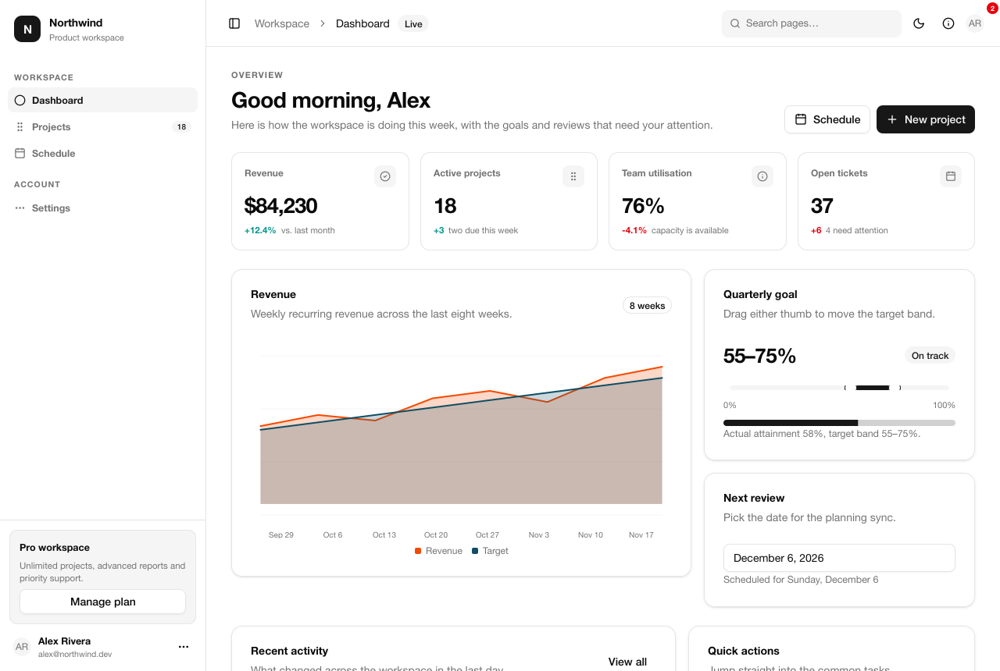

# DeclarativeDemo

A complete, runnable reference for AwAUI's Blazor-style declarative authoring model. The sample is a
small product workspace with a real application shell, five pages, forms, a data table, a calendar,
dialogs, tabs and toasts. Each page is written in `.awaui` markup with a `.awaui.cs` partial
code-behind and its own scoped `.awaui.css`. The project also demonstrates a component-global
`.awaui.global.css` and a project-shared stylesheet included with `<AwAUIGlobalStylesheet>`.

The preview above was produced by the sample itself, headlessly:



## Why this sample exists

Most AwAUI samples show one feature. This one is intentionally shaped like an application so it can
answer the questions that come up when authoring your own UI:

- How does markup become a component, and what belongs in the `.awaui` file versus `.awaui.cs`?
- How do parent components pass state and callbacks down, and how do children raise events up?
- How do controlled and uncontrolled component parameters differ?
- What exactly do scoped CSS, `::deep`, component-global CSS and project-global CSS each affect?
- How do you mix declarative markup with nodes built in C# (cell renderers, nav links, row actions)?
- How do you render and screenshot a page without a display?

Everything here is built with public AwAUI APIs. No internal helpers, no source changes and no
sample-specific hooks.

## Run it

```bash
# Native window (macOS, Windows or X11 when DISPLAY is set)
dotnet run --project samples/DeclarativeDemo

# Headless PNG, no display or GPU required
dotnet run --project samples/DeclarativeDemo -- --headless /tmp/declarative.png

# Pick the initial page and theme
dotnet run --project samples/DeclarativeDemo -- --headless /tmp/projects-dark.png --page projects --dark

# Set the window / framebuffer size and scale
dotnet run --project samples/DeclarativeDemo -- --headless /tmp/large.png --width 1440 --height 960 --scale 2
```

Page ids accepted by `--page`:

| Page id | What opens |
| --- | --- |
| `dashboard` | Dashboard (default) |
| `projects` | Projects with the data table |
| `project-dialog` | Projects with the New project dialog already open |
| `schedule` | Schedule with the range calendar |
| `settings` | Settings tabs |

Other flags: `--dark` starts in the dark theme, `--software` forces the software renderer when a GPU
window is available, and `--width`, `--height`, `--scale` control headless output. The process exits
non-zero if any `DiagnosticSeverity.Error` diagnostic is reported while rendering, which makes the
command usable in CI.

The headless path uses `HeadlessPlatform`, `ManualUIClock`, 24 deterministic frames and
`PngCodec.Save`. It does not require Metal, a window server or a connected display. The preview in
this repository was generated with the same command:

```bash
dotnet run --project samples/DeclarativeDemo --no-build -- \
  --headless samples/DeclarativeDemo/Previews/declarative.png
```

## File map

```
samples/DeclarativeDemo/
  DeclarativeDemo.csproj        composition references, global stylesheet, fonts, Markup generator
  Program.cs                    window/headless composition root and command-line parsing
  Models.cs                     records used by the pages, plus SampleData
  _Imports.awaui                shared @using directives for markup
  App.awaui                     application shell markup
  App.awaui.cs                  shell state, navigation, theme, notifications and toast helpers
  App.awaui.css                 scoped shell styles (also demonstrates ::deep)
  App.awaui.global.css          component-global styles for nodes built in App.awaui.cs
  Styles/app.css                project-shared tokens and utility classes
  Components/
    StatCard.awaui              small, reusable presentational component
    StatCard.awaui.cs           its public props
    StatCard.awaui.css          its scoped styles
  Pages/
    Dashboard.awaui             stats, chart, slider goal, date picker, activity, quick actions
    Dashboard.awaui.cs          chart data, goal and review-date state, navigation callbacks
    Dashboard.awaui.css         dashboard-only layout
    Projects.awaui              toolbar, column visibility, multi-sort, data table, dialog host
    Projects.awaui.cs           DataTableModel, columns, cell renderers, row actions
    Projects.awaui.css          page/toolbar styles plus ::deep into the table
    Projects.awaui.global.css   styles for code-built cells and row menus
    ProjectDialog.awaui         form inside a Dialog
    ProjectDialog.awaui.cs      FormController, validators, draft state, submit flow
    ProjectDialog.awaui.css     dialog form layout
    Schedule.awaui              two-month range calendar, range summary, availability
    Schedule.awaui.cs           controlled range state, disabled dates, toast helper
    Schedule.awaui.css          calendar/summary layout
    Settings.awaui              Profile/Notifications/Billing tabs, fields, destructive dialog
    Settings.awaui.cs           tab and form state, profile validation, confirm flow
    Settings.awaui.css          settings layout
  Previews/
    declarative.png             generated preview
```

The project references `AwAUI.Shadcn`, `AwAUI.Render`, `AwAUI.Imaging`, `AwAUI.Headless`, `AwAUI.MacOS`,
`AwAUI.Rhi.Metal`, `AwAUI.X11`, `AwAUI.Win32`, the Markup generator (analyzer) and the
`AwAUI.Generators` analyzer. It targets `net10.0` and is an executable.

## The authoring model

### One component, three files

For `X.awaui`, the Markup generator emits a partial class containing `Build()`, prop equality and
adoption helpers, the scoped stylesheet constant and a style-scope id. Your `X.awaui.cs` is another
partial of the same class. Key rules:

- Do **not** repeat the base class, the constructor or `Build()` in the code-behind. Write
  `public partial class X` only.
- Public properties on the partial are the component's **parameters** (props). A parent sets them as
  markup attributes, for example `Label="@stat.Label"`.
- `Action` / `Action<T>` properties are **events**. The parent passes a method group or lambda, for
  example `OnCreated="OnProjectCreated"`.
- `State<T>` fields hold mutable component state. Changing `.Value` requests a rebuild; the field
  itself survives rebuilds, unlike a local variable.
- Lifecycle overrides such as `OnMount` and `OnUnmount`, and `Invalidate()`, are available on
  `Component`. `IsMounted` guards work that may complete after unmount.
- The code-behind may build nodes directly. That is how nav links, DataTable cells and row action
  menus are produced.

`StatCard.awaui.cs` is the smallest example:

```csharp
public partial class StatCard
{
    public string Label { get; set; } = "";
    public string Value { get; set; } = "";
    public string Delta { get; set; } = "";
    public string Hint { get; set; } = "";
    public bool Positive { get; set; } = true;
    public SvgDocument? Icon { get; set; }
}
```

Its markup consumes those props directly and conditionally renders the icon:

```awaui
<div class="@Cx("stat-card", ("stat-up", Positive), ("stat-down", !Positive))">
    <div class="stat-top">
        <text class="stat-label">@Label</text>
        @if (Icon is not null)
        {
            <div class="stat-icon"><Svg Document="@Icon" /></div>
        }
    </div>
    <text class="stat-value">@Value</text>
    <div class="stat-foot">
        <text class="stat-delta">@Delta</text>
        <text class="stat-hint">@Hint</text>
    </div>
</div>
```

`Cx` appends classes conditionally. See `Components/StatCard.awaui` for the exact file.

### Markup syntax used in this sample

| Syntax | Example | Notes |
| --- | --- | --- |
| Component tag | `<AwAUI.Shadcn.Card>` | Tag maps to a component type. Qualified names avoid ambiguity. |
| Generic component tag | `<AwAUI.Shadcn.DataTable<ProjectRow> ... />` | The generic argument is part of the tag. `<DataTable T="...">` is not the supported form. |
| Attribute expression | `Value="@_query.Value"` | `@` introduces C#. |
| Literal attribute | `Value="Active"` | No `@` means a literal string/enum name. |
| Event attribute | `@onclick="OpenSettings"` | Shorthand event hook on intrinsic elements; components also expose named events such as `OnClick`. |
| Two-way convention | `Value="@_model.GlobalFilter" ValueChanged="OnSearch"` | Controlled value plus change callback. The component does not own state. |
| Uncontrolled default | `DefaultValue="..."`, `DefaultOpen` | Used when the component owns its state. |
| Conditional markup | `@if (...) { ... } else { ... }` | Normal C# blocks. |
| Loop | `@foreach (var item in Items) { ... }` | Every element/component in the loop needs `@key`. |
| Expression node | `@(NavLink(item))` | Emits a `Node` returned by code. |
| Text element | `<text class="muted">@Value</text>` | Intrinsic text node with a class. |
| Child content | `@onclick` / `Children` | Nested markup becomes the component's `Children`. |

Intrinsic elements are limited to the platform's primitives: `div`, `span`, `text`, `img`, `input`,
`textarea`, `canvas`, `svg` and `path`. There is no `aside`, `header` or `section`; use a `div` with a
class and, where useful, a role. The shell does exactly this with `.app-sidebar` and `.app-header`.

### Fully qualified component tags

`_Imports.awaui` imports `AwAUI.Shadcn`, but `Button` and `Input` also exist in `AwAUI.Controls` and
`AwAUI.UI`. In this project the unqualified names resolved to the wrong types, so every shadcn tag is
written with its namespace:

```awaui
<AwAUI.Shadcn.Button Variant="ButtonVariant.Outline" @onclick="OpenSettings">Manage plan</AwAUI.Shadcn.Button>
<AwAUI.Shadcn.Input Value="@_query.Value" ValueChanged="OnSearch" />
```

This is deliberate: it is the reliable form when two namespaces export the same type name. Other
components such as `StatCard`, `Dashboard` and `Projects` are unambiguous and are used unqualified.

### `@key`

`@foreach` requires a key on every emitted element/component, otherwise the Markup generator reports
`AW4008`. Keys let the reconciler preserve component state when a list changes. Examples in the
sample:

```awaui
<StatCard @key="stat.Label" Label="@stat.Label" ... />
<AwAUI.Shadcn.DropdownMenuItem @key="note.Title" ...>...</AwAUI.Shadcn.DropdownMenuItem>
<div class="app-nav-section" @key="section.Title">...</div>
```

For nodes returned from C#, set the `Key` property (`button.Key = item.Id` in `NavLink`).

### State and events across components

`App.awaui.cs` owns the page id, theme, search query, mobile sheet and notifications. It passes a
`ToastStore` to every page and callbacks such as `OnNavigate` and `OnNewProject` to `Dashboard`.
Pages call those callbacks to ask the shell to navigate; the page never mutates the shell directly.

`Dashboard` owns its slider and date state, `Projects` owns its `DataTableModel`, `ProjectDialog`
owns its `FormController`, `Schedule` owns the range, and `Settings` owns its form fields. All of
that state lives in code-behind fields so it survives rebuilds.

## CSS: three formats and their scope

AwAUI deliberately has three CSS layers. This sample uses all of them.

### 1. Project-shared stylesheet: `Styles/app.css`

Included in the project file:

```xml
<AwAUIGlobalStylesheet Include="Styles/app.css" />
```

The Markup generator merges the file into a generated `AwAUIGlobalStyles` class and registers it with
`AppStyleSheets` from a module initializer. It is available to every component, like Blazor's
`wwwroot/app.css`. This is where the sample puts design tokens (`--app-sidebar-width`,
`--app-header-height`, `--app-radius`) and genuinely shared layout utilities: `.page`, `.page-head`,
`.page-title`, `.muted`, `.tiny`, `.row`, `.stack`, `.spread`, `.toolbar-spacer`, `.icon-16`,
`.icon-14` and the responsive page padding. Do not put component-specific rules here.

### 2. Scoped stylesheet: `X.awaui.css`

A file next to `X.awaui` is compiled into that component's stylesheet. The generator appends a unique
scope attribute such as `[aw-cfef56d0]` to the last compound selector of each rule, and marks every
element produced by `Build()` with the same attribute. The result:

- `.app-header { ... }` only matches the header built by `App.Build()`.
- A nested child component host also carries the parent's scope attribute, so the parent can size the
  child's host (for example `.app-header` sizing a `Button`).
- The rules cannot leak into another component, even when both use a generic class name.

The scope attribute is generated; never write it by hand.

### 3. `::deep` inside a scoped stylesheet

Scoped CSS cannot normally reach elements created inside a child component. `::deep` opts a selector
out of the last scope boundary:

```css
/* App.awaui.css */
.app-search ::deep input {
    height: 34px;
    padding-left: 30px;
    background: var(--muted);
}
```

The `input` is produced by `AwAUI.Shadcn.Input`, not by `App.Build()`, so `.app-search input` would
not match. The same pattern appears in `Projects.awaui.css` for the data table's internal table
element. Use `::deep` narrowly: it is the escape hatch, not the default.

### 4. Component-global stylesheet: `X.awaui.global.css`

A file named `X.awaui.global.css` is registered when the component is used, but is **not** scoped.
It is the correct place for nodes the component creates in C#, because those nodes do not carry the
component's generated scope attribute:

- `App.awaui.global.css` styles `.app-nav-link`, `.is-active`, `.app-nav-icon`, `.app-nav-label` and
  `.app-nav-badge`. `NavLink()` builds an `AwAUI.Shadcn.Button` tree in code; those nodes never see
  the App scope.
- `Projects.awaui.global.css` styles `.project-name-cell`, `.project-status[data-status=...]`,
  `.project-updated`, `.project-budget`, `.row-actions` and `.row-action-icon`. The DataTable cell
  renderers and row `DropdownMenu` are code-built.

Component-global CSS is still registered by the component, so it is narrower than `app.css`: it only
exists while that component type participates in the app.

### Scope decision guide

| You are styling... | Put it in |
| --- | --- |
| Tokens, resets, shared utilities used by several pages | `Styles/app.css` |
| Elements written in `X.awaui` | `X.awaui.css` (scoped) |
| An element inside a child component, from the parent | `X.awaui.css` with `::deep` |
| A node returned by `X.awaui.cs` | `X.awaui.global.css` |
| A one-off class used only by code-built cells | the owning page's `.awaui.global.css` |

If a code-created node appears unstyled, check whether the rule lives in a scoped file. That is the
most common scoping mistake.

## Component and parameter reference

Only the parameters this sample uses are listed. Parameter names are C# property names; markup
spelling is the same unless noted. Events are `Action`/`Action<T>` properties and are passed method
groups or lambdas.

### Shell, layout and display

| Component | Key parameters / events | Used for |
| --- | --- | --- |
| `Card`, `CardHeader`, `CardTitle`, `CardDescription`, `CardContent`, `CardFooter` | `Class`, `Children` | Panels on every page. |
| `Button` | `Variant` (`ButtonVariant`), `Size` (`ButtonSize`), `Disabled`, `AsChild`, `Class`, `OnClick` | Actions, icon buttons, triggers, nav links. |
| `Badge` | `Variant` (`BadgeVariant`), `AsChild`, `Class` | Status, counts, live label, sort chips. |
| `Avatar`, `AvatarFallback` | `Size` (`AvatarSize`), `Class` | User and team avatars with initials. |
| `Progress` | `Value`, `Max`, `GetValueLabel`, `Class` | Quarterly goal progress (`Max="1"`). |
| `Separator` | orientation/style parameters | Menu separators. |
| `Svg` (intrinsic component) | `Document`, `Class` | Lucide icons. |
| `Breadcrumb`, `BreadcrumbList`, `BreadcrumbItem`, `BreadcrumbLink`, `BreadcrumbSeparator`, `BreadcrumbPage` | `OnClick`, `Href`, `AsChild`, `Class` | Header breadcrumb. |
| `Sheet`, `SheetContent`, `SheetHeader`, `SheetTitle`, `SheetDescription` | `Open`, `DefaultOpen`, `OnOpenChange`, `Side`, `Modal`, `Class` | Mobile navigation. |
| `Toaster` | `Store`, `Position`, `VisibleToasts`, `Hotkey`, `HotkeyEnabled`, `Class` | Sonner-style toast viewport. |

### Forms and input

| Component | Key parameters / events | Notes |
| --- | --- | --- |
| `Input` | `Value`, `ValueChanged`, `InputType`, `Placeholder`, `Disabled`, `ReadOnly`, `OnInput`, `OnChange`, `OnSubmit` | Search fields and text inputs. `OnSubmit` is used for the header search. |
| `Textarea` | `Value`, `ValueChanged`, `Placeholder`, `Disabled`, `Class` | Description and bio. |
| `Slider` | `Value`, `ValueChanged`, `Values`, `ValuesChanged`, `Min`, `Max`, `Step`, `MinStepsBetweenThumbs`, `Disabled`, `FormatValueText` | Single value in Settings; range (`Values`) for the quarterly goal. |
| `Switch` | `Id`, `Checked`, `DefaultChecked`, `CheckedChanged`, `Disabled`, `Size` | Notification toggles and "Notify the team". |
| `Checkbox` | `Id`, `Checked`, `DefaultChecked`, `CheckedChanged`, `Indeterminate`, `Disabled` | Selectable team members and product updates. |
| `RadioGroup`, `RadioGroupItem` | `Value`, `ValueChanged`, `Disabled`, `Orientation`; item `Value`, `Id` | Visibility and plan choices. |
| `Label` | `For`, `Class` | Radio and checkbox labels. |
| `Select`, `SelectTrigger`, `SelectValue`, `SelectContent`, `SelectItem` | `Value`, `ValueChanged`, `Open`, `OnOpenChange`, `Disabled`; item `Value` | Status filter, priority, channel. |
| `Combobox`, `ComboboxItem` | `Value`, `ValueChanged`, `Placeholder`, `Open`, `OnOpenChange`; item `Value` | Project owner picker. |
| `DatePicker` | `SelectedDate`, `SelectedDateChanged`, `IsSelectedDateControlled`, `Format`, `MinDate`, `MaxDate`, `DisabledDates`, `NumberOfMonths`, `Placeholder`, `Class` | Review date and project start date. |
| `Field`, `FieldSet`, `FieldLegend`, `FieldGroup`, `FieldContent`, `FieldTitle`, `FieldLabel`, `FieldDescription`, `FieldError` | `Orientation` (`FieldOrientation`), `Invalid`, `Disabled`, `For`, `Variant` (`FieldLegendVariant`), `Errors` | Non-`Form` field composition in Settings and the dialog. |
| `Form`, `FormField`, `FormItem`, `FormLabel`, `FormControl`, `FormDescription`, `FormMessage` | Form: `Controller`, `OnValid`, `OnInvalid`, `OnSubmit`; field: `Name`, `DefaultValue`, `Value`, `ValueChanged`, `Validators` | Validated project form. |
| `FormController` | `GetValue(name)`, `Submit()`, `Reset()`, `ErrorCount` | Owned by `ProjectDialog.awaui.cs`. |
| `FormValidators` | `Required`, `MinLength`, `MaxLength`, ... | Name and description rules. |

`FormField` wires its `FormControl` child to the controller by `Name`. `FormMessage` reads the
field's error. `ProjectDialog` calls `_controller.Submit()` from the Create button; the controller
runs validators and raises `OnValid` or `OnInvalid`.

### Data

| Component / type | Key API | Notes |
| --- | --- | --- |
| `DataTable<T>` | `Model`, `Rows`, `Columns`, `RowKey`, `PageSize`, `PageSizes`, `Filterable`, `Paginated`, `Selectable`, `SelectAllScope`, `Label`, `Caption`, `Class`, `StateChanged` | Set `Filterable="false"` because the page supplies its own search box. |
| `DataTableModel<T>` | `EnableMultiSort`, `SortDescriptors`, `SelectedCount`, `SelectedKeys`, `PageCount`, `PageIndex`, `PageRows`, `SetRows`, `SetGlobalFilter`, `SetColumnFilter`, `ClearAllFilters`, `ToggleSort(key, multiColumn)`, `AddSort`, `ClearSort`, `GetSortDirection`, `GetColumnVisibility`, `SetColumnVisibility`, `SetPageSize`, `SetPageIndex`, `SetSelected`, `ClearSelection` | The model is the source of truth for filter, sort, paging and selection across pages. |
| `DataTableColumn<T>` | `Key`, `Header`, `Cell`, `Value`, `SortValue`, `FilterValue`, `Filter`, `EnableSorting`, `EnableHiding`, `Width`, `Align`, `Class`, `HeaderClass` | `Width` is a CSS width (`8rem`, `34%`), not a grid track. |
| `Table`, `TableHeader`, `TableBody`, `TableRow`, `TableHead`, `TableCell` | `Columns`, `Class` | Static invoice table in Settings. |
| `Chart` | `Kind` (`ChartKind`), `Labels`, `Series`, `Config`, `Height`, `ShowLegend`, `ShowGrid`, `ShowAxis`, `Class` | `ChartSeries` and `ChartConfig` live in code-behind. |

The page observes `DataTableModel.Changed` in `OnMount` and calls `Invalidate()`, unsubscribing in
`OnUnmount`. The table's own toolbar and the page's custom toolbar both drive the same model.

### Overlays, menus, navigation and feedback

| Component | Key parameters / events | Notes |
| --- | --- | --- |
| `Dialog`, `DialogContent`, `DialogHeader`, `DialogTitle`, `DialogDescription`, `DialogFooter` | `Open`, `DefaultOpen`, `OnOpenChange`, `Modal`, `Class` | Project form and destructive confirm. |
| `DropdownMenu`, `DropdownMenuTrigger`, `DropdownMenuContent`, `DropdownMenuLabel`, `DropdownMenuSeparator`, `DropdownMenuItem`, `DropdownMenuCheckboxItem` | `Open`, `OnOpenChange`, `AsChild`, `Align` (`PopperAlign`), `OnSelect`, `Destructive`, item `Checked`, `CheckedChanged` | Notifications, column visibility, sort menu, row actions. |
| `Tabs`, `TabsList`, `TabsTrigger`, `TabsContent` | `Value`, `ValueChanged`, `Orientation`, trigger `Value`, content `Value` | Settings pages. |
| `Calendar` | `SelectionMode` (`CalendarSelectionMode`), `IsRangeControlled`, `RangeStart`, `RangeEnd`, `RangeChanged`, `DisabledDates`, `NumberOfMonths`, `ShowOutsideDays`, `FirstDayOfWeek`, `Culture` | Two-month range calendar. |
| `ToastStore.Show(ToastOptions)` | `Title`, `Description`, `Variant` (`ToastVariant`), `Duration`, `ActionLabel`, `OnAction` | Raised by pages. `Toaster` renders the store passed down from `App`. |

`ToastVariant` values used here: `Default`, `Info`, `Success`, `Warning`, `Error`.

The sample intentionally does not use `AlertDialog` for the destructive confirmation; it shows that
the same `Dialog` component can be staged in code-behind with controlled state, which is useful when
the confirm flow also needs validation or analytics.

## What each page demonstrates

### Dashboard

- Four `StatCard` components in a keyed `@foreach`.
- `Chart` with two series and a code-behind `ChartConfig` dictionary.
- A range `Slider` (`Values`/`ValuesChanged`) that drives a computed status badge and `Progress`.
- A controlled `DatePicker` with a minimum date.
- A keyed activity list and a quick-action grid that raises shell navigation callbacks.
- Parent callbacks `OnNavigate` and `OnNewProject`.

### Projects

- External `DataTableModel<ProjectRow>` with `EnableMultiSort`.
- Page-owned toolbar: global search, status `Select` mapped to a column filter, column visibility
  checkbox menu, multi-layer sort menu, selection count and clear.
- Sort chips built from `SortDescriptors`.
- Row selection across pages (`SelectedCount`).
- Seven columns including code-built name/status/updated/budget cells and a per-row actions menu.
- New project dialog, row duplicate/delete, and toasts for every mutation.

### ProjectDialog

- `Form` + `FormController` with `Required`, `MinLength(3)` and `MaxLength(240)` validators.
- `FormField`/`FormItem`/`FormControl`/`FormMessage` for inline errors.
- `Combobox` owner picker, `Select` priority, `DatePicker` start date, member checkboxes and a
  `Switch`.
- `OnValid` creates a `ProjectDraft`, raises a success toast and resets; `OnInvalid` raises a warning
  toast with the error count.
- Cancel and Reset both clear controller and local state.

### Schedule

- Controlled range `Calendar` with `IsRangeControlled`, two months and disabled weekends/holidays.
- Summary that shows start-only, complete range and cleared states.
- Team availability list keyed by member name.
- Share action uses the `ToastStore` passed down from the shell.

### Settings

- `Tabs` with three independent `TabsContent` panels.
- Profile `FieldSet`/`FieldGroup` with avatar, name/email/bio inputs, a `Slider`, a `RadioGroup` and a
  checkbox.
- Inline `FieldError` validation when the display name is too short.
- Notification switches plus delivery `Select`.
- Billing plan radios, static invoice `Table`, and a destructive confirm `Dialog`.

## Declarative markup versus code-behind

| Concern | Prefer markup | Prefer code-behind |
| --- | --- | --- |
| Static tree | `X.awaui` | - |
| Conditional/list rendering | `@if`, `@foreach` with `@key` | - |
| Purely presentational props | - | public properties on `X.awaui.cs` |
| State that survives rebuilds | - | `State<T>` fields |
| Event handlers and navigation | `@onclick` for simple hooks | methods for multi-step logic |
| Reusable cell renderers | - | `Func<T, Node>` returning a node tree |
| Large computed trees (row menus, nav links) | - | C# with `Children`, `Rest`, `Key` |
| Scoped styles for markup | `X.awaui.css` | - |
| Styles for code-built nodes | - | `X.awaui.global.css` or `app.css` |

When a code-built node needs an attribute that is not a typed property, use its `Rest` dictionary
(`AttributeDictionary`). The sample sets `aria-current`, `aria-label` and `data-status` this way.
Accessibility attributes written in markup pass through as ordinary attributes.

## Gotchas this sample documents by construction

- **Ambiguous type names.** Fully qualify `AwAUI.Shadcn.Button` and `AwAUI.Shadcn.Input`. Merely
  importing `AwAUI.Shadcn` in `_Imports.awaui` is not enough when another namespace exports the same
  simple name.
- **Keys are mandatory in loops.** `AW4008` is a build error. Add `@key` to every item, and set
  `Key` on nodes returned by code.
- **Intrinsic element set.** There is no `aside`/`header`/`section`; use a styled `div`. Unknown tags
  produce `AW4002`.
- **DataTable column width.** `Width` becomes a CSS `width`; `minmax(...)` is invalid there and
  produces `AW2003`. Use lengths or percentages. The sample uses auto width for Project, `8.5rem`
  for Status, `11rem` for Owner, `8rem` for Priority/Updated, `7rem` for Budget and `3rem` for the
  actions column.
- **Two-phase generation.** The Markup generator first discovers props and then emits `Build()`
  glue. A missing prop on a component surfaces as `CS1061` at the call site, not in the component
  file. Check the prop name used by the parent (`Label`, not `Title`, for `StatCard`).
- **Scoped CSS cannot see code-built nodes.** This is the most common surprise. Move those rules to
  `.global.css` (or `app.css`).
- **Display culture.** `Program.cs` pins `CultureInfo.InvariantCulture` so month names and dates are
  deterministic in headless previews. In a real application, choose the culture from platform
  preferences instead.
- **Icon set.** The sample uses only icons that exist in `LucideIcons`: `ArrowDown`, `ArrowLeft`,
  `ArrowRight`, `Calendar`, `Check`, `ChevronDown/Left/Right/Up`, `ChevronsUpDown`, `Circle`,
  `CircleCheck`, `Ellipsis`, `GripVertical`, `Info`, `LoaderCircle`, `Minus`, `Moon`, `OctagonX`,
  `PanelLeft`, `Plus`, `Search`, `Sun`, `TriangleAlert`, `X`, `MoreHorizontal`. There is no `Bell`,
  `Settings`, `Folder` or `LayoutDashboard` icon in this set, so the sample uses `Info` for the
  notification trigger and `Ellipsis`/`GripVertical`/`Circle` elsewhere.

## Testing

`tests/AwAUI.Samples.Tests/DeclarativeDemoTests.cs` is a `[Theory]` over all five page ids. Each case:

1. Creates a `HeadlessPlatform`, a 1280x900 window, a `SoftwareRenderBackend`, a `UIHost` and a
   `ManualUIClock`.
2. Collects every `UIDiagnostic`.
3. Mounts `new DeclarativeDemo.App { Page = page }`.
4. Advances 24 frames so mount effects, theme attributes and dialog/toast entrances settle.
5. Asserts the framebuffer exists and is non-empty, the PNG encoding is larger than 4 KiB, and no
   `Error` or `Warning` diagnostics were reported.

Run it per project, not through the solution:

```bash
dotnet test tests/AwAUI.Samples.Tests/AwAUI.Samples.Tests.csproj -f net10.0 \
  --filter FullyQualifiedName~DeclarativeDemoTests
```

The test project references `samples/DeclarativeDemo/DeclarativeDemo.csproj` and loads the bundled
Noto Sans font from `tests/TestFiles/Fonts`. It calls `ShadcnTheme.Register()` once in a static
constructor so the shadcn tokens are present before the first mount.

## Building

```bash
dotnet build samples/DeclarativeDemo/DeclarativeDemo.csproj
```

The project sets `WarningLevel` high so Markup `AW4xxx` warnings stay visible. A clean build is
expected to produce zero warnings and zero errors. The sample is listed under `/samples` in
`AwAUI.slnx`.

## Related reading

- `design/14-awaui-format.md` - component file format and code-behind model.
- `design/17-awaui-grammar.md` - markup grammar, generics, `@key` and intrinsic elements.
- `design/08-css.md` - scoped CSS, `::deep`, component-global and project-global styles.
- `design/19-text-api.md`, `design/21-gesture-scroll-api.md`, `design/22-controls.md` - the controls
  and primitives used above.
- `samples/ShadcnGallery` - a gallery that exercises every shadcn component with fewer pages.
- `samples/Counter` - the smallest declarative component and event sample.
